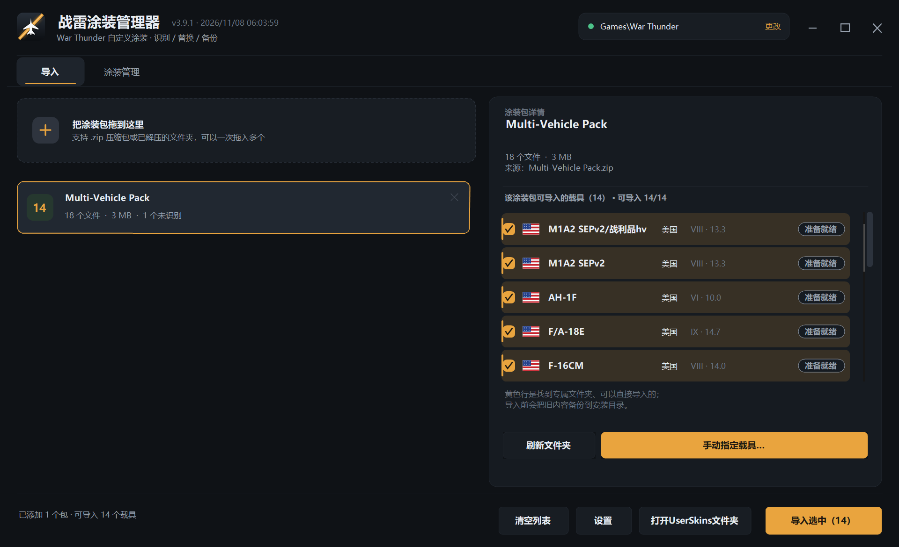
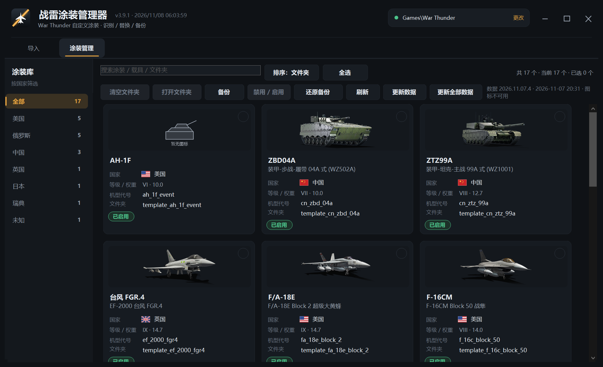
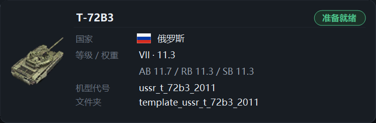

# 战雷涂装管理器（WTSkinManager）

一个 Windows 小工具：把下载到的《战争雷霆》第三方自定义涂装包拖进来，自动认出它属于哪台载具，然后写进游戏 `UserSkins` 里**游戏自己生成的载具文件夹**；同时提供涂装启用/禁用、备份/还原、离线载具图标与等级权重显示。

[](LICENSE)
[](https://github.com/Nchoneko/WTSkinManager/releases)
[](#4-环境要求)

[](https://github.com/Nchoneko/WTSkinManager/releases/latest)
[](https://gitee.com/orgon/WTSkinManager/releases)
[](https://github.com/Nchoneko/WTSkinManager/releases/latest)
[](https://gitee.com/orgon/WTSkinManager)

> 当前版本 **v3.9.25**（程序内版本 `3.9.25.0`，载具数据 `2026.11.11.3`）。
>
> **v3.9.13 本次改动**：新增应用内自动更新（本页内下载 / 断点续传 / SHA-256 校验 / 替换后自动重启）、
> 更新镜像兜底与失败提示；下载方式改为「GitHub Releases 单文件 exe」唯一推荐，Gitee 改为历史存档、不再自动同步。

---

## 1. 项目简介

WTSkinManager 是一个**非官方**的《战争雷霆》自定义涂装管理工具，使用 C# / .NET Framework 4.x 编写，发布为单个 `WTSkinManager.exe`。它解决三件事：

1. **认得出**：读取涂装包里的 `.blk` 文件名与贴图规则，匹配到具体载具；
2. **装得对**：只写入游戏已经生成的 `template_<载具ID>` 文件夹，不新建、不改名、不碰游戏本体；
3. **管得住**：导入后可以清空、备份、还原、禁用/启用，并离线显示载具图标与等级/权重。

程序不收集任何数据。默认在启动时静默检查 GitHub Releases 是否有新版本（可在设置页关闭）；只有在你主动点击「更新数据 / 更新全部数据」时才会访问 War Thunder Wiki。

---

## 2. 截图

**导入页**：拖入涂装包后自动列出可导入载具、国家、等级/权重与文件夹状态。



**涂装管理**：按国家筛选的卡片网格，显示载具图标、国家、等级/权重、机型代号、文件夹与启用状态。



**等级 / 权重浮层**：三档不一致时补一行 AB / RB / SB 明细。



> 截图使用隔离沙盒与合成示例数据，不含真实用户名、个人目录或聊天窗口。

---

## 3. 功能特性

- **导入识别**
  - 支持 `.zip` 压缩包与已解压的文件夹，可一次拖入多个。
  - 按 `.blk` 文件名匹配载具内部 ID；匹配不上时读取 `.blk` 里的 `from` 贴图规则再猜一次；仍认不出可手动指定。
  - 多型号合集包会全部列出，默认只勾选本机已有模板文件夹的型号，避免一次复制几个 GB。
  - 导入前按扩展名三档校验：`.dds/.blk/.tga` 正常安装；`.txt/.md/.pdf/.jpg/.ini/.url/.rtf` 忽略并事后列出；`.png/.exe/.bat/...` 或未知扩展名弹窗确认，默认取消。
- **只写入游戏文件夹**
  - 只操作 `UserSkins` 下已经存在的 `template_<载具ID>` 或 `<载具ID>` 文件夹。
  - 导入前自动备份旧内容；导入时先清空目标载具文件夹，再写入新涂装。
- **涂装管理**
  - 左侧国家筛选（全部置顶，其余按数量降序），右侧卡片网格，最多三列。
  - 卡片显示载具图标、两行标题、国家旗帜、等级/权重、机型代号、文件夹、启用/禁用状态。
  - 支持搜索、排序、全选当前可见项、多选批量操作。
- **启用 / 禁用**
  - 只给文件夹名追加或去掉 `.BAN`，幂等、可逆，不改目录内任何文件；失败自动回滚。
- **备份 / 还原 / 清空**
  - 备份保留目录结构，可还原到原位置；清空默认先备份、默认取消，失败回滚。
  - 备份、日志、缓存、撤销副本都在安装目录，不写进游戏目录。
- **等级 / 权重**
  - 随包 `vehicle_meta.dat` 提供基础数据，首次运行即可显示。
  - 点击「更新数据」只采集本机已有模板文件夹的载具；「更新全部数据」遍历 Wiki 的 30 条科技树线（10 国 × 3 分支）。
  - 请求间隔 ≥ 1 秒、超时 10 秒、单条最多重试 2 次；连续失败超过 10 条自动暂停；进度逐条落盘，可断点续跑。
- **离线图标**
  - 约 2027 张载具 PNG 随程序分发，索引为 `assets/vehicles/manifest.json`；构建时打进单文件 exe。
  - 渲染只按清单查图，按需加载、LRU 缓存最近 96 张，**不发起任何图片网络请求**；缺失时显示统一占位图。
- **界面**
  - 自绘深色标题栏与四套主题（暗夜琥珀 / 军绿战术 / 冷蓝夜航 / 纸白）。
  - 75%–150% 缩放，Per-Monitor V2 DPI，高分屏不发虚。
  - 全部动画可关闭。
- **单文件分发**
  - 图标、载具表、等级/权重、名称映射、发布者公钥证书全部内嵌进一个 exe，运行时无需附带 `assets/` 目录。

---

## 4. 环境要求

| 项目 | 要求 |
| --- | --- |
| 操作系统 | Windows 10（1809+）/ Windows 11，x64 |
| 运行时 | .NET Framework 4.x（Windows 10/11 自带，无需单独安装） |
| 权限 | 普通用户即可；**不要**安装到 `C:\Program Files` 等需要管理员权限的目录 |
| 网络 | **可选**。导入、管理、图标与已缓存数据完全离线；只有点击「更新数据 / 更新全部数据」时才联网访问 War Thunder Wiki，只有点「下载更新」时才下载新版本（GitHub 或镜像） |
| 磁盘 | 程序本体约 180 MB；备份占用取决于涂装包大小 |
| 构建 | Windows 自带的 `csc.exe`（.NET Framework 4.x）与 PowerShell 5.1；Node.js/npm 仅用于执行快捷脚本，不是必需 |

---

## 5. 安装方式

### 方式一：下载 Releases（推荐）

**唯一推荐：GitHub Releases 上的单文件 `WTSkinManager.exe`。**

- **GitHub Releases（唯一发布渠道）**：<https://github.com/Nchoneko/WTSkinManager/releases>
  —— 每个版本都有自己的 tag 页面（例如 `releases/tag/v3.9.12`）与附件直链，
  下载里面的 `WTSkinManager.exe` 即可；单文件、无需安装运行时，同一页面还附带
  `WTSkinManager.exe.sha256` 与发布说明。
- **Gitee 不再自动同步**：<https://gitee.com/orgon/WTSkinManager/releases> 里的内容只是
  **历史存档**（Gitee 单附件限制 100MB，旧版本被拆成 `.7z.001/.002/.003` 分卷 + `parts.sha256`）。
  存档可能不是最新版本，**不建议**从这里取新版本；新版本请看上面的 GitHub Releases。

1. 打开 GitHub Releases（最新版直达：<https://github.com/Nchoneko/WTSkinManager/releases/latest>），
   下载最新版本的 `WTSkinManager.exe`，并核对 SHA-256（见下方命令）。
2. 放到一个普通可写目录（例如 `D:\Tools\WTSkinManager`），双击运行。
3. 首次运行会弹出安装向导：
   - 选择**安装目录**：程序、设置、备份、日志都放这里；不要选 `C:\Program Files`。
   - 选择**游戏目录**：选到包含 `UserSkins` 和 `aces.exe` 的那一层，例如 `...\steamapps\common\War Thunder`。
   - 可选「安装发布者签名」：把随包的自签公钥证书导入当前用户的「受信任的发布者」，减少 Windows 的未知发布者提示；不需要管理员权限，可随时在设置里移除。
4. 安装完成后即可使用。程序是单文件，没有独立卸载器；删除安装目录即可（先确认备份已不需要）。

校验下载到的安装包（`certutil` 是 Windows 自带命令，不需要装任何工具）：

```powershell
# 结果应与 Release 附件 WTSkinManager.exe.sha256 里的哈希一致
certutil -hashfile .\WTSkinManager.exe SHA256

# 也可以直接查看附件内容再比对
Get-Content .\WTSkinManager.exe.sha256
```

> 如果 Windows SmartScreen 提示「已保护你的电脑」：点「更多信息」→「仍要运行」，或右键 exe → 属性 → 勾选「解除锁定」。

### 方式二：从源码构建

需要 Windows 10/11 与 .NET Framework 4.x（自带），**不需要** .NET SDK 或 Visual Studio。

```bash
git clone https://github.com/Nchoneko/WTSkinManager.git && cd WTSkinManager && npm install && npm run build
```

产物为 `out/WTSkinManager.exe`（单文件，约 180 MB），直接双击运行：

```powershell
# 等价的 PowerShell 命令（不依赖 npm）
powershell -NoProfile -ExecutionPolicy Bypass -File build/build.ps1
powershell -NoProfile -ExecutionPolicy Bypass -File build/start.ps1
```

其他脚本：

```powershell
npm run check:version   # 校验 AssemblyInfo.cs 与 package.json 版本一致
npm run pack            # 生成 out/WTSkinManager-v3.9.1.0-win64.zip（含 exe/LICENSE/NOTICE/README）
npm run sign            # 可选签名；需设置 WTSM_SIGN_PFX / WTSM_SIGN_PASSWORD，未设置则跳过
```

---

## 6. 使用说明

### 6.1 第一次使用

1. **先在游戏里创建模板文件夹**：进入游戏 → 外观 → 涂装 → 对目标载具点「创建涂装示例」，游戏会生成 `UserSkins\template_<载具ID>`。
2. 回到程序，点右上角游戏路径 →「更改」，选择战雷安装目录（包含 `UserSkins` 与 `aces.exe` 的那一层）。
3. 把涂装 `.zip` 拖进左侧虚线区域，或点击该区域选择文件。
4. 右侧会列出这个包能导入的载具；黄色行表示已找到对应文件夹，可以直接导入。
5. 勾选目标载具 →「导入选中」；程序会先备份旧内容，再清空该载具文件夹并写入新涂装。
6. 如果提示「未识别到文件夹」，回游戏创建模板后点「刷新文件夹」。

### 6.2 目录选择

- **安装目录**：设置、备份、日志、缓存都在这里；建议 `D:\Tools\WTSkinManager` 这类普通目录。
- **游戏目录**：必须包含 `UserSkins` 文件夹与 `aces.exe`；Steam 常见路径为 `...\steamapps\common\War Thunder`。
- 程序不会把备份或缓存写进游戏目录；游戏目录下只读写 `UserSkins`。

### 6.3 常见操作

| 操作 | 位置 | 说明 |
| --- | --- | --- |
| 导入涂装 | 导入页 | 拖入 zip/文件夹，勾选载具，点「导入选中」 |
| 刷新文件夹 | 导入页右下 | 在游戏里新建模板文件夹后点一次 |
| 手动指定载具 | 导入页右下 | 自动识别失败时手动选载具 |
| 筛选 / 搜索 | 管理页 | 左侧国家筛选、顶部搜索框 |
| 启用 / 禁用 | 管理页工具栏 | 只改文件夹名，追加/去掉 `.BAN` |
| 备份 | 管理页工具栏 | 未选中时备份全部；保留目录结构 |
| 还原备份 | 管理页工具栏 | 选择备份时间点还原 |
| 清空文件夹 | 管理页工具栏 | 只清空当前勾选；默认先备份、默认取消 |
| 更新数据 | 管理页工具栏 | 只采集已有模板的载具；全部更新遍历 30 条科技树线 |
| 主题 / 缩放 | 设置 | 修改后需重启程序生效 |

### 6.4 安装目录里的文件

```
WTSkinManager.exe
settings.ini                 # 游戏目录、主题、缩放、备份目录等
shortnames.ini               # 国家显示名 / 载具简称映射（可编辑）
installed.flag               # 安装完成标记
backups\                     # 旧涂装备份；管理器备份在 backups\skins
logs\import.log              # 导入日志
cache\vehicle_meta.ini       # 等级/权重缓存（逐条落盘，可续跑）
cache\vehicle_meta_queue.ini # Wiki 科技树队列
cache\vehicle_meta_failed.ini# 采集失败记录
unmatched.txt                # 未匹配载具清单
shortnames_unmatched.txt     # 简称回退全名的载具清单
```

### 6.5 应用内自动更新

从 v3.9.12 起，可以在设置页里直接下载并安装新版本，不用再手动去网页下载：

1. 打开「设置 → 更新与日志」，看到「发现新版本」后点「下载更新」（就是原来「前往下载」按钮的位置）。
2. 下载在本页内完成，不弹浏览器：按钮变灰、右侧出现「取消」；下方显示进度条、百分比与
   「已下载 / 总大小」，右侧显示实时速度与剩余时间（1 秒滑动窗口 + EMA 平滑，样本不足时显示「计算中…」）。
3. 中途点「取消」会保留已下载的 `.part`，按钮变成「继续下载」；再点时从断点续传（HTTP 206）。
   网络抖动时显示「网络中断，正在重试 n/3」，程序自动退避重试 3 次（1、2、4 秒）。
4. 下载完成会显示「正在校验…」，用 Release 提供的 SHA-256 校验安装包；不一致会删除文件并提示
   「文件校验失败，请重试或到 GitHub 下载」，不会进入安装。
5. 校验通过弹出「更新已就绪」，显示新旧版本、包大小与「SHA-256 校验通过」：
   - 「立即更新」：关闭当前程序 → 备份旧 exe → 替换 → 自动重新启动；
   - 「稍后」（或按 Esc）：保留已下载的包，设置页显示「更新已下载，可立即安装」，下次点「立即安装」再走。
6. 替换失败会自动回滚到旧版本，并在下次启动时提示「更新失败，已回滚到 vX」；
   安装目录不可写时会提示用管理员身份运行，或把程序放到可写目录。

相关文件（都不在游戏目录里）：

| 路径 | 内容 |
| --- | --- |
| `%LOCALAPPDATA%\WTSkinManager\updates\<版本>\WTSkinManager.exe` | 已下载并校验通过的安装包 |
| `%LOCALAPPDATA%\WTSkinManager\updates\<版本>\WTSkinManager.exe.part` | 未下完的断点文件（取消后保留） |
| `%LOCALAPPDATA%\WTSkinManager\updates\update.log` | 替换日志（旧/新版本、SHA-256、结果） |
| `%LOCALAPPDATA%\WTSkinManager\backups\WTSkinManager_<旧版本>_<时间戳>.exe` | 替换前的旧 exe（保留最近 3 份） |

---

## 7. 目录结构

```
WTSkinManager/
├─ LICENSE                     # Apache-2.0 完整原文
├─ NOTICE                      # 第三方组件、素材与商标说明
├─ README.md                   # 本文件
├─ CHANGELOG.md                # 版本更新日志
├─ .gitignore                  # 排除构建产物、运行期数据、私钥
├─ package.json                # 版本号与 npm 快捷脚本
├─ src/                        # C# 源码（.NET Framework 4.x / C# 5）
│  ├─ Program.cs               # 入口、安装流程、DPI
│  ├─ MainForm.cs              # 主窗口、自绘标题栏、分页、拖放、导入流程
│  ├─ ManagerForm.cs           # 涂装管理：国家筛选、卡片网格、管理操作
│  ├─ PageTabs.cs              # 「导入 / 涂装管理」分页
│  ├─ InstalledSkins.cs        # 顶层目录枚举、.BAN 禁用/启用
│  ├─ ImportValidation.cs      # 三档导入校验
│  ├─ NameMap.cs               # 名称映射与简称提取
│  ├─ Dialogs.cs               # 安装 / 设置 / 选载具 / 缺文件夹 / 确认 / 进度 / 结果
│  ├─ Ui.cs                    # 主题、缩放、动画、自绘控件
│  ├─ Config.cs                # 安装目录、设置、游戏目录探测
│  ├─ VehicleDb.cs             # 载具表、国家/国旗、搜索、模糊匹配
│  ├─ VehicleMeta.cs           # 等级/权重：内置数据 + Wiki 采集 + 本地缓存
│  ├─ VehicleCatalog.cs        # 图标清单：manifest.json、sha256 去重、状态机
│  ├─ VehicleIcons.cs          # 运行时取图：按清单查表、LRU、占位图（零网络）
│  ├─ VehicleIconUpdater.cs    # 图标采集任务：间隔 / 超时 / 重试 / 断点
│  ├─ SkinPackage.cs           # zip/文件夹解析、blk 识别
│  ├─ Importer.cs              # 导入计划、备份、清空目标文件夹后写入
│  ├─ PublisherCert.cs         # 发布者公钥证书校验与导入
│  ├─ UpdateEngine.cs          # 程序更新与数据更新
│  ├─ UpdateDownload.cs        # 应用内更新下载：续传 / 重试 / 镜像 / SHA-256
│  ├─ UpdateInstaller.cs       # 替换助手：备份 / 原子替换 / 回滚 / update.log
│  ├─ UpdateReadyDialog.cs     # 6px 下载进度条与「更新已就绪」弹窗
│  ├─ SemVer.cs / History.cs / Util.cs / ...
│  └─ app.manifest             # Per-Monitor V2 DPI
├─ assets/
│  ├─ icons/
│  │  ├─ app.ico               # 应用图标（多尺寸）
│  │  └─ icon-256.png          # 界面左上角图标
│  ├─ vehicles/                # 2027 张载具 PNG + _placeholder.png
│  │  └─ manifest.json         # 图标索引（slug/file/sha256/nation/rank/status…）
│  ├─ data/
│  │  ├─ vehicles.dat          # 载具 ID → 中文名 / 英文名
│  │  ├─ nations.dat           # 载具 ID → 国家
│  │  ├─ vehicle_meta.dat      # 等级 / 权重基础数据
│  │  ├─ shortnames.ini        # 国家显示名 / 载具简称与规则
│  │  ├─ updates.dat           # 程序内更新日志
│  │  └─ data-version.ini      # schemaVersion / dataVersion
│  ├─ certs/publisher.cer      # 自签发布者证书（仅公钥，无私钥）
│  └─ SOURCES.md               # 素材来源与版权说明
├─ docs/                       # 截图、说明与发布流程（release.md）
└─ build/
   ├─ build.ps1                # 一键构建：校验 → 生成 zip → csc → exe
   ├─ check-version.ps1        # AssemblyInfo ↔ package.json 版本一致
   ├─ pack.ps1                 # 生成发布压缩包
   ├─ sign.ps1                 # 可选 Authenticode 签名（环境变量证书）
   └─ start.ps1                # 启动构建产物
```

构建产物 `out/`、从 PNG 重新生成的 `assets/vehicles.zip`、运行期 `settings.ini` / `backups/` / `logs/` / `cache/` 均被 `.gitignore` 排除，不进入仓库。

---

## 8. FAQ

### 8.1 识别失败，提示「未识别到文件夹」怎么办？

- 先在游戏里对目标载具执行「创建涂装示例」，`UserSkins` 下出现 `template_<载具ID>` 后，回程序点「刷新文件夹」。
- 程序只认 `.blk` 文件名与载具内部 ID 一致（例如 `ef_2000_fgr4.blk`）；文件名不对时会尝试读取 `.blk` 里的 `from` 规则，仍失败可点「手动指定载具」。
- 合集包里的 `.blk` 名不是载具 ID 时，导入过程中会自动改名；如果仍无法判断，请把包内 `.blk` 文件名与载具 ID 对照后手动指定。
- 极新的载具可能还没进内置载具表，手动输入/选择载具 ID 即可。

### 8.2 图标缺失或显示「暂无图标」？

- 图标随程序版本打包，渲染不联网；清单里 `status=retrying/permanent` 或文件缺失时显示统一占位图。
- 点击「更新数据」会顺带补齐缺失图标（请求间隔 ≥1 秒、单条最多 2 次）；也可以在「设置」的图标覆盖率窗口导出缺失清单。
- 自行补充图标：把 `<slug>.png` 放进 `assets/vehicles/`，更新 `manifest.json` 后重新构建；构建脚本会校验大小（≤120KB）与 SHA-256。
- 若安装目录残留旧版 `assets/vehicles/manifest.json` 且版本不一致，程序会忽略它并在日志中提示，可手动删除。

### 8.3 数据不更新 / 等级权重显示「—」？

- 等级/权重只在点击「更新数据 / 更新全部数据」时联网访问 War Thunder Wiki；断网或 Wiki 限流时会保留旧缓存并显示「—」。
- 采集是断点续跑的：中断后再点会从队列继续，已完成的条目不重复请求；失败记录在 `cache\vehicle_meta_failed.ini`。
- 匹配不上或采集失败的载具会写入 `unmatched.txt`；连续失败超过 10 条会自动暂停并提示。
- 如果启动时提示数据 `schemaVersion` 不一致，说明安装目录残留了旧版数据文件，删掉该外部文件后程序会使用内置数据。

### 8.4 安装时提示目录不可写？

- 优先点「改用默认目录」；桌面/文档常被安全软件保护。
- 换到 `D:\Tools\WTSkinManager` 这类普通文件夹最稳；管理员权限不一定能解决安全软件拦截。
- 不要安装到 `C:\Program Files`。

### 8.5 程序会修改游戏文件吗？

- 不会。程序对游戏目录只读写 `UserSkins`；不碰 `aces.exe`、`config.blk` 或游戏本体。
- 禁用只重命名涂装文件夹（追加 `.BAN`），不改目录内容；启用时去掉。

### 8.6 支持 `.rar` / `.7z` 吗？

- 只支持 `.zip` 与已解压文件夹；`.rar` / `.7z` 请先解压。

### 8.7 构建时报「签名失败」或没有签名？

- 默认构建不会签名，`WTSM_SIGN_PFX` 未设置时 `build/sign.ps1` 会直接跳过。
- 需要签名时设置 `WTSM_SIGN_PFX` 与 `WTSM_SIGN_PASSWORD`，并安装 Windows SDK 的 `signtool.exe`；私钥 `.pfx` 不要提交到仓库。

### 8.8 下载更新很慢或总是失败？

- 更新包下载会走**系统代理**设置（检查更新本身是直连 GitHub API）。直连慢时，先挂梯子或让系统代理生效，再点「重试下载」。
- 直连失败时程序会按 `settings.ini` 里的 `DownloadMirrors=` 顺序探测镜像：每条先发 `Range: bytes=0-0` 探测、3 秒超时，失败换下一个。默认三条模板：
  - `https://ghfast.top/https://github.com/Nchoneko/WTSkinManager/releases/download/v{version}/WTSkinManager.exe`
  - `https://gh-proxy.com/https://github.com/Nchoneko/WTSkinManager/releases/download/v{version}/WTSkinManager.exe`
  - `https://ghproxy.net/https://github.com/Nchoneko/WTSkinManager/releases/download/v{version}/WTSkinManager.exe`

  `{version}` 会替换成 `3.9.13` 这样的三段版本号；把这一行改成空字符串即可完全关闭镜像。
- 镜像下载同样做 SHA-256 校验，校验不过不会安装。全部失败时界面提示「GitHub 直连失败，可挂梯子重试，或使用国内镜像下载」，并给出「打开 GitHub 页面」按钮。
- 也可以直接去 GitHub Releases 手动下载单文件 exe；Gitee 只剩历史存档（旧分卷），**不要**从那里取新版本。
- 仍然失败请在 Issues 反馈，附上 `logs\import.log` 与 `%LOCALAPPDATA%\WTSkinManager\updates\update.log`。

---

## 9. 免责声明

1. **与产品无关**：本项目是个人开发的非官方第三方工具，与 Gaijin Entertainment 及其关联公司没有任何隶属、合作、赞助或背书关系；项目名称、界面与文档中出现的「War Thunder」「战争雷霆」仅用于说明兼容对象。
2. **商标归属**：War Thunder、战争雷霆及相关名称、标识、载具名称与游戏素材是 Gaijin Entertainment 或其权利人的商标/版权财产；本项目不主张任何相关权利。
3. **只读写 `UserSkins`**：程序对游戏目录只读写 `UserSkins` 下的用户涂装文件夹，不修改 `aces.exe`、`config.blk`、游戏本体或反作弊相关文件；不会替你新建游戏内模板文件夹。
4. **后果自负**：使用本工具导入、覆盖、清空、重命名或还原涂装文件夹所产生的任何后果（包括涂装丢失、游戏内显示异常、账号风险等）由使用者自行承担；请自行确认操作对象与备份。
5. **Wiki 数据误差**：等级/权重、载具名称与图标来自 War Thunder Wiki、官方百科图床与公开数据项目，可能存在滞后、缺失、错配或版本差异；程序按「原样」展示，不保证准确性与完整性。
6. **图标版权**：载具图标仅用于在界面中识别、展示对应载具，版权归 Gaijin Entertainment 及各权利人所有，**不在 Apache-2.0 授权范围内**；权利人如要求移除，请通过 Issues 联系。
7. **按现状提供**：软件按「现状」（AS IS）提供，不附带任何明示或暗示的担保，包括但不限于适销性、特定用途适用性与不侵权担保；作者不对使用或无法使用本软件造成的任何直接、间接、附带或后果性损失负责。
8. **先备份**：在执行清空、覆盖、禁用/启用、还原等操作前，请先自行备份 `UserSkins` 与安装目录；程序内置的备份不能替代你自己的完整备份。

---

## 10. 协议说明

- 本项目代码与自制图形以 **Apache License 2.0** 授权，完整原文见 [LICENSE](LICENSE)。
- 版权行：`Copyright 2026 Nchoneko`。
- 第三方组件、素材来源、商标与修改说明见 [NOTICE](NOTICE) 与 [assets/SOURCES.md](assets/SOURCES.md)。
- 载具图标、游戏名称、Wiki 数据不属于 Apache-2.0 授权范围，仅作为识别展示素材随程序分发；详见免责声明第 6 条。
- 仓库不包含任何私钥、证书私钥文件、Token 或账号密码；`assets/certs/publisher.cer` 只含公钥。

---

## 11. 贡献与反馈

欢迎提交 Issue 与 Pull Request：

- **Bug 反馈**：请附上程序版本（标题栏或 `settings.ini`）、Windows 版本、复现步骤、相关日志（`logs\import.log`）与脱敏后的截图。
- **功能建议**：说明使用场景与期望行为，尽量给出可复现的例子。
- **Pull Request**：保持 C# 5 / .NET Framework 4.x 兼容；不要引入 NuGet 依赖；提交前运行 `npm run check:version` 与 `npm run build`。
- **不要**在 Issue/PR 中粘贴私钥、证书密码、Token、账号密码或包含个人路径的完整日志；请先脱敏。
- 载具图标缺失/错误：请提供载具 slug 与 Wiki 页面链接，便于核对 `manifest.json`。

问题跟踪：[Issues](https://github.com/Nchoneko/WTSkinManager/issues)

---

## 12. 赞助

暂不接受赞助。如果这个工具帮到了你，给仓库点一个 Star、在 Issues 里反馈问题，就是最好的支持。

---

## 13. 下载与反馈

- **Releases（下载，GitHub）**：<https://github.com/Nchoneko/WTSkinManager/releases>
- **历史存档（Gitee，不再自动同步）**：<https://gitee.com/orgon/WTSkinManager/releases>
- **Issues（反馈）**：<https://github.com/Nchoneko/WTSkinManager/issues>
- **源码仓库（GitHub）**：<https://github.com/Nchoneko/WTSkinManager>
- **源码仓库（Gitee 镜像）**：<https://gitee.com/orgon/WTSkinManager>

从源码构建（Windows 10/11，需 .NET Framework 4.x）：

```bash
git clone https://github.com/Nchoneko/WTSkinManager.git && cd WTSkinManager && npm install && npm run build
```

产物：`out/WTSkinManager.exe`。版本号以 `src/AssemblyInfo.cs` 为准，`package.json` 的 `version` 必须与其前三段一致（`npm run check:version` 会校验）。
